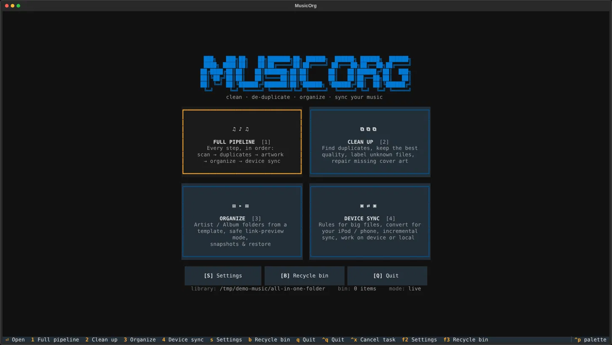
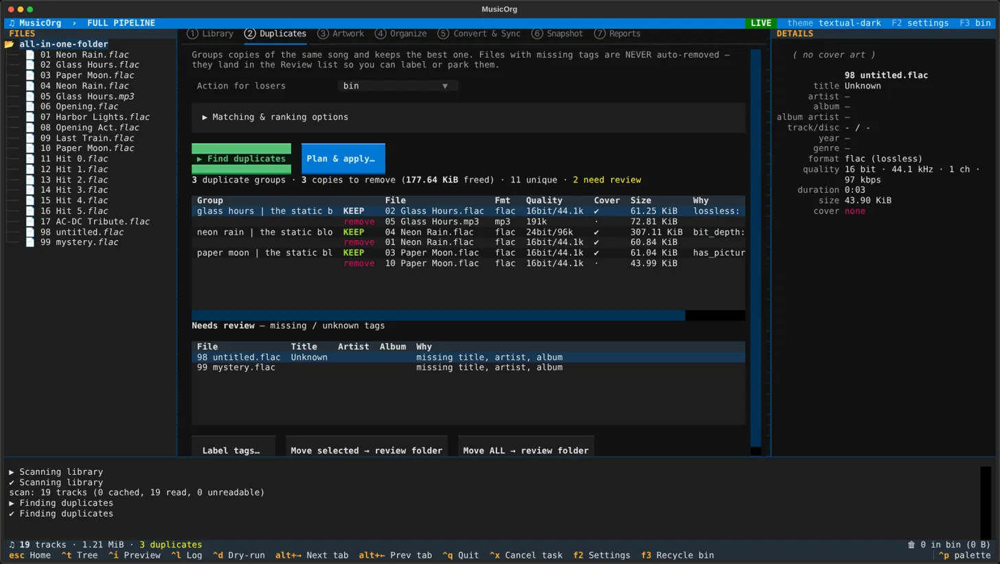
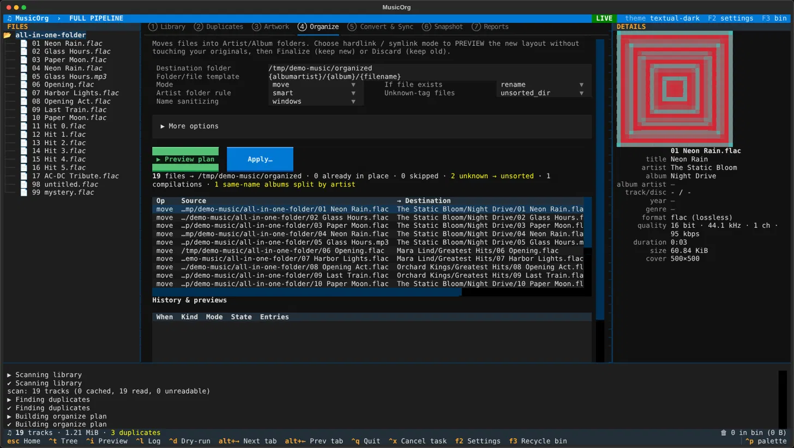

# MusicOrg

**Clean up a messy music library from your terminal.** Find duplicates and keep the best copy, repair missing cover art,
sort everything into `Artist/Album` folders, and prepare a smaller copy for your iPod or phone.

Nothing happens until you press **Apply**, deleted files go to a recycle bin, and every run can be undone.



---

## Features

- **Duplicates**: groups copies of the same song and keeps the best one (lossless over lossy, higher bit depth and sample rate, has a cover, and so on). You choose the ranking.
- **Safe with untagged files**: songs with missing tags are never auto-removed. They go to a *Review* list where you can label them or move them to a folder.
- **Artwork repair**: fills missing covers from a duplicate, another track of the same album, or a `cover.jpg` in the folder.
- **Organize**: moves files into `Artist/Album` folders from a template you control. Can **preview** the result with hardlinks or symlinks without touching your originals.
- **Device sync**: rules like "files over 200 MiB become 16-bit/44.1 kHz FLAC", incremental, never upsamples.
- **Snapshots**: save a folder structure to JSON and rebuild it later (for example on your iPod).
- **Safety net**: recycle bin, undo journal, dry-run mode, and a plan you can review row by row before anything changes.
- **Everything is configurable**: thresholds, paths and features can all be changed or turned off.

Supported formats: FLAC, MP3, M4A, OGG, Opus, WAV, AIFF.

---

## Install

You need **Python 3.11+**. **ffmpeg** is only needed for conversion (Device sync).

```bash
git clone <your-repo-url> musicorg
cd musicorg
pip install .
```

## Run

```bash
musicorg                                   # start the app
musicorg --root ~/Music                    # add a music folder for this session
musicorg --root ~/Music --root /media/you/IPOD/Music
```

Want to try it without risking your real collection? Make a fake library first:

```bash
python scripts/make_demo_library.py /tmp/demo
musicorg --root /tmp/demo/all-in-one-folder
```

---

## Quick start

1. On the home screen pick a task: **Full pipeline**, **Clean up**, **Organize** or **Device sync** (keys `1`–`4`).
2. In the **Library** tab, add your music folder and press **Scan**. The other tabs unlock when the scan finishes.
3. Work through the tabs, left to right or in any order.
4. Every action first shows a **plan** (what will happen to which file). Untick rows you don't want, then **Apply**, or use **Simulate** to see the result without changing anything.

The workspace has the file tree on the left, the tabs in the middle, and details with a cover thumbnail on the right.
Stats and the recycle bin count are shown in the corners.

### Clean up duplicates

Go to **Duplicates** and press **Find duplicates**. Each group shows `KEEP` and `remove` rows with the reason.
Files with missing tags appear under **Needs review**: label them with **Label tags…** or move them to a review folder.
Press **Plan & apply…** to send the losing copies to the recycle bin (or quarantine/delete, your choice).



### Organize into Artist/Album folders

Go to **Organize**, set the destination folder, and press **Preview plan**. It tells you how many files are already in place,
how many have unknown tags (they go to `_Unsorted`), how many albums were split by artist, and how many compilations were found.



Choose the **mode** that fits your confidence:

| Mode | What it does |
|---|---|
| `move` | moves files (can be undone) |
| `copy` | copies files, originals stay |
| `hardlink` / `symlink` | **preview**: builds the new layout, originals stay. Afterwards press **Finalize** to keep the new layout, or **Discard** to remove it |

### Sync to a device

Go to **Convert & Sync**, set the target folder (your iPod mount, for example) and edit the **rules**.
The first matching rule decides what happens to each file: `copy`, `link`, `convert` or `skip`.
You can prepare the copy locally first, or point the Library at the device and work on it directly.

### Recycle bin

Press `F3` anywhere. **Restore** puts a file back where it came from; **Delete permanently** and **Empty the bin** ask for confirmation.

---

## Keys

| Key | Action |
|---|---|
| `1`–`4` | open a task (home screen) |
| `Esc` | back to home |
| `Alt+←` / `Alt+→` | previous / next tab |
| `Ctrl+T` / `Ctrl+I` / `Ctrl+L` | show or hide file tree / details / log |
| `Ctrl+D` | dry-run on/off (Apply only simulates) |
| `Ctrl+X` | cancel the running task |
| `F2` | settings |
| `F3` | recycle bin |
| `Space`, `A`, `N` | in a plan: toggle row, all on, all off |
| `Ctrl+Q` | quit |

## Settings

Press `F2`. Every option is listed by section with a short explanation. Changes are saved to
`~/.config/musicorg/config.toml`, which you can also edit by hand.

Your data (library cache, recycle bin, undo journals, plans, snapshots, log) lives in `~/.local/share/musicorg`.
Change it with `general.data_dir`. Putting `trash.bin_dir` on the same disk as your music makes "move to bin" instant.

Handy options to know:

| Option | What it controls |
|---|---|
| `dedupe.match_fields` | which tags must match for two files to be duplicates |
| `dedupe.criteria`, `dedupe.tie_tolerance_pct` | how the best copy is chosen |
| `dedupe.action` | `report`, `quarantine`, `bin` or `delete` for the losing copies |
| `organize.template` | folder and file names, e.g. `{albumartist}/{album}/{track:02} {title}` |
| `organize.sanitize_profile` | `windows` is safe for FAT32/NTFS/exFAT (iPods) |
| `organize.unknown_policy` | what happens to files with unknown tags |
| `convert.rules` | the device sync rules (size, sample rate, bit depth, format → action) |

---

## Safety

- Nothing is changed until you press **Apply** in a plan dialog.
- Duplicates go to the recycle bin by default; permanent deletion asks first.
- Every applied run is written to a journal, so moves, copies, links, bin sends and tag edits can be undone (Organize tab → History).
- Hardlink/symlink previews never touch your originals until you press Finalize.

---

# Developer's guide

## Big picture

```
 scan ──► Track list ──► find / build ──► Plan ──► Executor ──► Journal
(scanner)   (models)    (dedupe, artwork,   (a list of     (applies it,    (undo, finalize,
                         organize, convert,  Actions)       dry-run aware)   discard)
                         snapshot)
```

The key idea: **nothing changes files directly.** Every feature builds a `Plan` (a list of `Action`s such as `move`,
`trash`, `convert`). The `Executor` applies a plan and writes a `Journal`. The TUI only shows plans and presses the button.

`musicorg/core` contains no UI code. The TUI (`musicorg/tui`) and any future GUI are thin layers on top of it.

## Project layout

```
musicorg/
├── __main__.py            entry point and command-line arguments
├── core/                  all the logic, no UI
│   ├── config.py          every option, TOML load/save
│   ├── models.py          Track: one audio file's metadata
│   ├── tags.py            read/write tags and cover art
│   ├── scanner.py         library scan + SQLite cache
│   ├── dedupe.py          duplicate detection and keeper choice
│   ├── artwork.py         find missing covers and donors
│   ├── organize.py        build the Artist/Album plan
│   ├── convert.py         sync rules and ffmpeg
│   ├── snapshot.py        export/restore folder structure
│   ├── reports.py         statistics and exports
│   ├── plan.py            Action and Plan
│   ├── executor.py        applies a Plan
│   ├── journal.py         undo / finalize / discard
│   ├── trash.py           the recycle bin
│   └── util.py            sanitizing, text normalising, sizes
└── tui/                   Textual interface
    ├── app.py             App, shared state, background tasks
    ├── home.py            home screen with the task tiles
    ├── workspace.py       main screen: tree, tabs, details panel, status
    ├── panes.py           the seven tabs
    ├── modals.py          plan review, tag editor, rule editor, confirm
    ├── settings.py        settings screen
    ├── binscreen.py       recycle bin screen
    └── styles.tcss        all styling
scripts/make_demo_library.py   builds a fake library for trying things
tests/                          core tests and headless TUI tests
```

## Core modules

**`config.py`**: Options are dataclasses (`ScanCfg`, `DedupeCfg`, `OrganizeCfg`, …) declared with `opt(default, help, choices)`.
The Settings screen and the tab controls are generated from these declarations, so **adding an option is one line**.
Config is stored as TOML (a small writer is built in, so there's no extra dependency).

**`models.py` / `tags.py`**: `Track` holds the path, tags, audio properties (sample rate, bit depth, bitrate, duration),
whether it is lossless, and the cover's size. `tags.py` uses `mutagen` to read FLAC, MP3, M4A, Ogg/Opus, WAV and AIFF,
and to embed covers and write basic tags.

**`scanner.py`**: Walks the folders (honouring formats and include/exclude globs) and reads tags in a thread pool.
Results are cached in SQLite keyed by path, size and modification time, so re-scans only read changed files.

**`dedupe.py`**: Builds a key from the configured tags (normalised: case, punctuation, optional brackets),
splits groups whose durations differ too much, and optionally merges byte-identical files by hash.
Files missing a required tag are never grouped: they go to the review list.
`choose_keeper` walks the ranking criteria in order; numeric criteria within the tie tolerance count as equal and the next criterion decides.

**`artwork.py`**: For each track with no cover (or a too-small one) it looks for a donor in the configured order:
a duplicate, a sibling from the same album, or a folder image. Output: `embed_art` actions.

**`organize.py`**: Two steps. First `resolve_owners` decides each album's artist folder (album-artist tag, else the dominant artist,
else split by artist, else "Various Artists"). Then `dest_for` renders the template, sanitizes every name, and handles collisions
(`skip` / `rename` / `overwrite` / `keep_larger`). Unknown-tag files go to the unsorted folder.

**`convert.py`**: `decide` returns the first enabled rule that matches a track. `build_plan` makes copy/link/convert actions,
skips files already up to date, and can list orphans on the device. `convert_file` runs ffmpeg into a `.partial` file and renames it when done.

**`snapshot.py`**: `export_structure` saves the tree to JSON. `restore_plan` indexes the source folder once and builds move/copy/link actions
to recreate the saved layout. Old-format snapshots load too.

**`plan.py` / `executor.py`**: `Action(op, src, dst, params, note, enabled)`. The executor handles `move`, `copy`, `hardlink`, `symlink`,
`trash`, `delete`, `convert`, `embed_art`, `extract_art`, `tag` and `cleanup`. It supports dry-run, cancel, progress callbacks,
and optional parallel workers (used for conversion).

**`journal.py`**: Every applied action is appended to a JSONL file. `undo` reverses a run, `finalize` makes a hardlink/symlink/copy preview permanent,
`discard` removes a preview.

**`trash.py`**: The recycle bin: files are moved into `bin/items/<id>/` with a manifest, so they can be restored to their original location.

## TUI modules

- **`app.py`** holds `AppState` (scanned tracks and the latest results) and `bg()`, which runs any function in a thread with progress and cancel,
  then calls back on the UI thread. After state changes it calls `on_state_changed` on the open screens.
- **`workspace.py`** builds the screen from the chosen workflow's tab list, locks tabs that need a library, and shows the details panel for whatever is selected.
- **`panes.py`** has one class per tab. Controls with an id like `cfg-organize__template` are bound to the config automatically (the workspace saves the value on change).
- **`modals.py`**: `PlanReviewScreen` is where every plan is reviewed and applied.

## Common tasks

**Add a config option**: add a field to a dataclass in `config.py` with `opt(...)`. It appears in Settings automatically.
To show it in a tab, add `cinput`, `cselect` or `cswitch` there.

**Add a new action type**: add the `op` handling in `Executor._do`, and, if it can be undone, in `journal.undo`.

**Add a tab**: write a pane class in `panes.py` (named `<Name>Pane`), add its title in `workspace.PANE_TITLES`, and add its id to a workflow in `home.WORKFLOWS`.
If it needs a scanned library, add it to `NEEDS_LIBRARY`.

**Use the core without the UI** (this is how a GUI would use it):

```python
from musicorg.core.config import Config
from musicorg.core import scanner, dedupe
from musicorg.core.executor import Executor

cfg = Config.load()
tracks = scanner.scan(cfg, ["~/Music"]).tracks
result = dedupe.find_duplicates(tracks, cfg)
plan = dedupe.build_plan(result, cfg)
Executor(cfg, dry_run=True).run(plan)      # simulate first
```

## Tests

```bash
pip install -e ".[dev]"
pytest
```

The tests generate real audio files with ffmpeg, so ffmpeg must be installed. `tests/test_core.py` covers scanning, duplicates, artwork,
organizing, previews, conversion, snapshots, the bin and undo. `tests/test_tui.py` drives the interface headlessly.

## Gotchas

- Textual's tab view switches back to the tab of whichever widget has focus. Use `WorkspaceScreen.goto("tab_id")`, which clears focus first.
- Screens already have attributes named `workers` and `mode`. Don't reuse those names on a screen.
- The same widget id (for example `#preview`) can exist in several tabs, so query inside the pane (`self.query_one`), not the whole screen.
